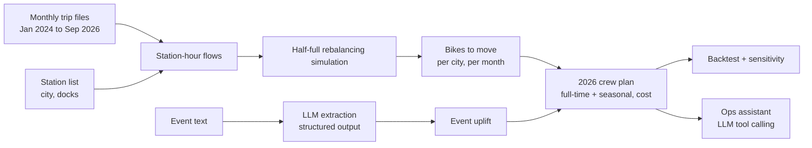

# Bluebikes Crew Planner

A month-by-month 2026 plan of full-time and seasonal rebalancing crews for each city in the Bluebikes network, built from real trip data, with two GenAI features: an LLM event extractor and a tool-calling operations assistant.

## What it does
1. Aggregates real Bluebikes trips (January 2024 to September 2026) to station-hour arrivals and departures.
2. Simulates each station starting the day half full and counts the bikes that must be moved, by city and month.
3. Uses an LLM with structured output to turn event text (Boston Marathon, Head of the Charles, college move-in) into a clean events table, and measures the effect of event days on rebalancing need.
4. Forecasts 2026 need and builds a crew plan that follows the hiring, release, and seasonal contract rules, with total cost and lost revenue.
5. Backtests the plan against real January–September 2026 trips and runs sensitivity checks (ridership ±20%, e-bike growth).
6. Answers what-if questions through an LLM agent that calls the plan functions as tools.

**Headline results:** 2026 crew cost of $944,700, seasonal crews peaking at the 8-crew cap, and a backtest shortfall of about 23,300 bikes (about $133,000) concentrated in Boston and Cambridge in summer. See section 11 of the notebook.

## Architecture


## Setup
1. Install Python 3.10 or later, then:
   ```bash
   pip install -r requirements.txt
   ```
2. Download the station list CSV from https://bluebikes.com/system-data and save it as `data/stations.csv`.
3. Set your OpenAI API key without putting it in the code, for example in a `.env` file or by running the notebook's `getpass` cell:
   ```bash
   export OPENAI_API_KEY="your-key"
   ```
4. Open `Bluebikes_Crew_Planner.ipynb`, set `RUN_LLM = True`, paste event text into `EVENT_TEXT`, and run all cells. Trip files download automatically from the public Bluebikes bucket and are cached in `data/`.
5. To test the code without downloads, set `DEMO_MODE = True` to run on small synthetic data.

## Repository contents
| File | Purpose |
|---|---|
| `Bluebikes_Crew_Planner.ipynb` | Full pipeline, with every cell run and outputs visible |
| `requirements.txt` | Python dependencies |
| `README.md` | This file |
| `.gitignore` | Keeps `data/` and `.env` (API key) out of the repo |

## Team contributions
| Member | Contributions |
|---|---|
| [Name] | [e.g., data loading, station-hour flows, rebalancing simulation] |
| [Name] | [e.g., LLM event extraction, operations assistant] |
| [Name] | [e.g., crew plan, cost model, sensitivity analysis] |
| [Name] | [e.g., backtest, report, README, demo video] |

## AI use
We used Claude to draft starter code for the notebook and to help structure this README and the report. The team reviewed, ran, tested, and edited all of it, and the notebook's first cell marks the AI-assisted code. Inside the product, an OpenAI model (via LangChain) extracts events with structured output and powers the tool-calling assistant; all numbers come from our code, not the model.

## Data
Trip and station data are published by Bluebikes under the Bluebikes Data License Agreement (https://bluebikes.com/system-data). Crew capacity, costs, and starting crew levels are planning assumptions given in the assignment.
